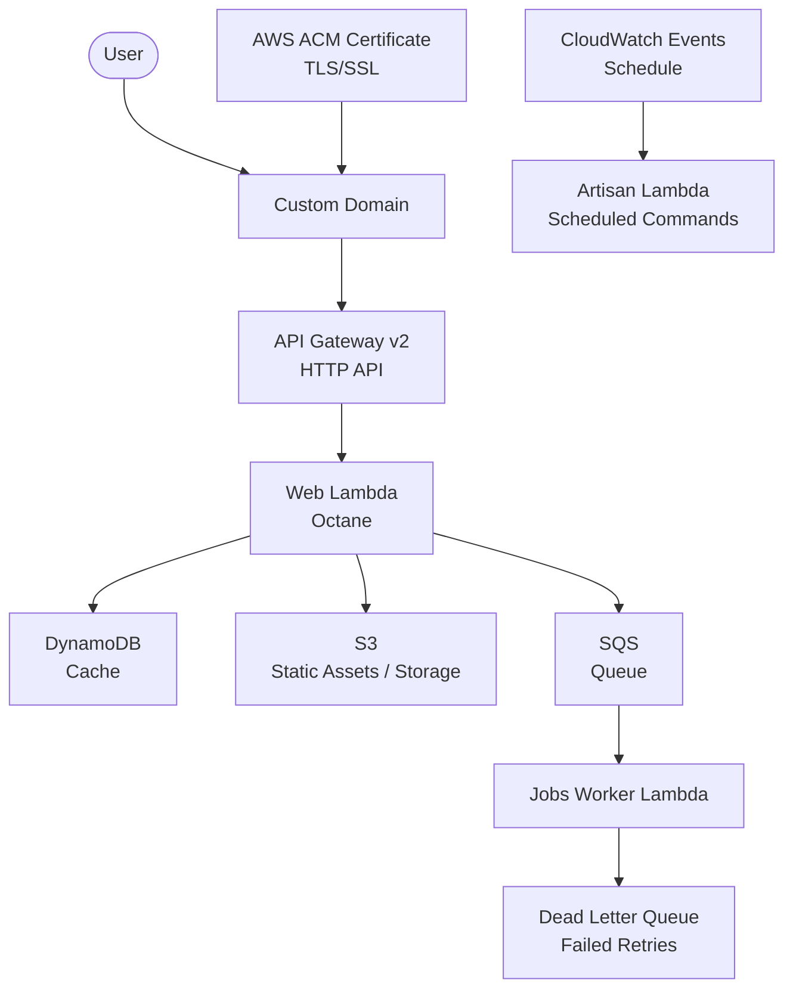

# Laravel Serverless

Deploy Laravel applications to AWS Lambda using [Terraform](https://www.terraform.io/) (or [OpenTofu](https://opentofu.org/)).

AWS Lambda does not natively support PHP. This project uses [Bref](https://bref.sh/) — an open-source PHP runtime provided as a Lambda Layer — along with the [Laravel Bridge](https://github.com/brefphp/laravel-bridge) to run Laravel on Lambda with minimal modifications.

> Bref officially uses [Serverless Framework](https://www.serverless.com/) to provision AWS resources, which deploys via CloudFormation under the hood. This project was created by converting the CloudFormation template to Terraform HCL using [cf2tf](https://github.com/DontShaveTheYak/cf2tf), then refined and optimized.

## Architecture



### Lambda Functions

| Lambda          | Purpose                | Handler                                 | Memory  | Timeout |
| --------------- | ---------------------- | --------------------------------------- | ------- | ------- |
| **Web**         | Handle HTTP requests   | `Bref\LaravelBridge\Http\OctaneHandler` | 1024 MB | 28s     |
| **Artisan**     | Run scheduled commands | `artisan`                               | 1024 MB | 720s    |
| **Jobs Worker** | Process SQS queue jobs | `Bref\LaravelBridge\Queue\QueueHandler` | 1024 MB | 60s     |

### AWS Services

| Service                   | Purpose                                         |
| ------------------------- | ----------------------------------------------- |
| **API Gateway v2 (HTTP)** | Route HTTP requests to Web Lambda               |
| **AWS ACM**               | TLS/SSL certificate for custom domain           |
| **DynamoDB**              | Laravel cache driver (with TTL auto-expiration) |
| **SQS**                   | Laravel queue driver with Dead Letter Queue     |
| **CloudWatch Logs**       | Log group per Lambda (1-day retention)          |
| **S3**                    | Static assets (CSS/JS) and file storage         |
| **VPC** (optional)        | Access VPC resources (e.g., RDS databases)      |
| **EFS** (optional)        | Persistent filesystem mounted at `/mnt/efs`     |

## File Structure

```text
laravel-serverless/
├── terraform/
│   ├── main.tf             # Orchestrator combining all submodules
│   ├── data.tf             # Shared data sources (Caller identity, S3 bucket)
│   ├── provider.tf         # AWS provider configuration
│   ├── terraform.tf        # Terraform version constraints and S3 backend
│   ├── variables.tf        # Input variable declarations (supports TF_VAR_*)
│   ├── outputs.tf          # Stack outputs from submodules
│   └── modules/
│       ├── api_gateway/    # HTTP API, custom domain, ACM, integrations & routes
│       ├── dynamodb_cache/ # DynamoDB cache table with TTL
│       ├── sqs_queue/      # SQS job queue & Dead Letter Queue (DLQ)
│       └── laravel_compute/# Web (Octane), Artisan (Scheduler), Worker Lambdas + IAM + CloudWatch
└── .github/
    └── workflows/
        ├── _deploy-laravel-template.yaml  # Reusable deployment template
        ├── _destroy-laravel-template.yaml # Reusable destruction template
        ├── deploy-blog.yaml               # Deploy Blog
        ├── destroy-blog.yaml              # Destroy Blog
        ├── deploy-cms.yaml                # Deploy CMS
        ├── destroy-cms.yaml               # Destroy CMS
        ├── deploy-ai-agent.yaml           # Deploy AI Agent
        └── destroy-ai-agent.yaml          # Destroy AI Agent
```

## Prerequisites

- [Terraform](https://www.terraform.io/) or [OpenTofu](https://opentofu.org/)
- AWS CLI with configured credentials
- An S3 bucket for Terraform state storage
- A validated TLS certificate on [AWS ACM](https://aws.amazon.com/certificate-manager/) for the API Gateway custom domain

## Quick Start

### 1. Package the Laravel Application

```bash
git clone YOUR_LARAVEL_REPO_URL laravel-app
cd laravel-app

# Install production dependencies
composer install --prefer-dist --optimize-autoloader --no-dev

# Clear cached config (Lambda uses environment variables — cached config will override them)
php artisan config:clear

# Build frontend assets
npm ci && npm run build

# Remove unnecessary files
rm -rf node_modules tests storage .git .github

# Create the deployment zip
zip --quiet --recurse-paths --symlinks "../laravel-app.zip" .
cd ..
```

> **Important**: Do NOT run `php artisan config:cache`. Lambda injects environment variables via `$_ENV` at runtime — caching config will cause those variables to be ignored.

### 2. Create the Environment Variables File

Create `environment-variables.json` with your Laravel environment variables:

```json
{
  "APP_NAME": "My App",
  "APP_KEY": "base64:...",
  "APP_ENV": "production",
  "DB_CONNECTION": "pgsql",
  "DB_HOST": "your-rds-endpoint",
  "DB_DATABASE": "your_database",
  "DB_USERNAME": "your_username",
  "DB_PASSWORD": "your_password",
  "ASSET_URL": "https://your-s3-bucket.s3.amazonaws.com"
}
```

> `ASSET_URL` must point to the S3 bucket URL where static assets are hosted, since Lambda cannot serve static files directly.

### 3. Create Terraform Configuration Files

Create `terraform.config` (backend configuration):

```conf
bucket="your-terraform-state-bucket"
key="your-app.tfstate"
region="us-west-2"
dynamodb_table="your-terraform-lock-table"
```

Create `terraform.tfvars`:

```hcl
app_name = "my-laravel-app"

# VPC settings (enable if you need access to RDS or other VPC resources)
enable_vpc         = true
subnet_ids         = ["subnet-xxx", "subnet-yyy"]
security_group_ids = ["sg-xxx"]

# EFS settings (enable if you need a persistent filesystem)
enable_filesystem = true
access_point_arn  = "arn:aws:elasticfilesystem:us-west-2:123456789:access-point/fsap-xxx"

# API Gateway — uses a TLS certificate from AWS ACM
certificate_arn    = "arn:aws:acm:us-west-2:123456789:certificate/xxx-xxx"
custom_domain_name = "app.example.com"

# Tags
tag_service     = "my-app"
tag_environment = "production"
tag_owner       = "team-name"

# S3
aws_bucket = "my-app-storage"

# Lambda
environment_variables_json_file = "./environment-variables.json"
filename                        = "./laravel-app.zip"

# Extra Lambda layers (optional) — e.g. a custom GD extension layer.
# Leave empty for the Bref PHP layer only. See "Custom PHP Extensions" below.
extra_lambda_layer_arns = []
```

### 4. Deploy

```bash
cd terraform

# Initialize Terraform
terraform init -backend-config="./terraform.config"

# Preview changes
terraform plan

# Apply
terraform apply -auto-approve

# Sync frontend static assets to S3
aws s3 sync ../laravel-app/public s3://your-asset-bucket
```

### 5. Configure DNS

After deployment, point your custom domain to API Gateway:

```bash
aws apigatewayv2 get-domain-name --domain-name app.example.com
```

Create a CNAME or ALIAS record at your DNS provider pointing to the returned API Gateway domain name target.

## Bref Lambda Layer

Since AWS Lambda does not natively support PHP, this project relies on [Bref](https://bref.sh/) Lambda Layers to provide the PHP runtime. Layer ARNs should be updated periodically.

Find the latest versions at [Bref Runtimes](https://runtimes.bref.sh/) (select the correct region and CPU architecture).

This project uses ARM64. Default layer:

```text
arn:aws:lambda:us-west-2:873528684822:layer:arm-php-85:12
```

Override via the `php_lambda_layer_arn` variable in `terraform.tfvars`.

## Deploying a New Laravel App (新增一個 Workflow 即可)

This repository acts as a centralized serverless deployment engine. To deploy a new Laravel application, you only need to create a new workflow file under `.github/workflows/deploy-<app>.yaml`:

```yaml
name: Deploy New App to AWS Lambda

on:
  workflow_dispatch:

permissions:
  id-token: write
  contents: read

jobs:
  deploy:
    uses: ./.github/workflows/_deploy-laravel-template.yaml
    with:
      app_name: ${{ vars.NEW_APP_NAME }}
      github_repo_url: ${{ vars.NEW_APP_GITHUB_URL }}
      custom_domain_name: ${{ vars.NEW_APP_CUSTOM_DOMAIN_NAME }}
      certificate_arn: ${{ vars.NEW_APP_CERTIFICATE_ARN }}
      aws_bucket: ${{ vars.NEW_APP_AWS_BUCKET }}
      asset_bucket: ${{ vars.NEW_APP_ASSET_AWS_BUCKET }} # Optional: skip if no static sync
      enable_vpc: true
      subnet_ids: ${{ vars.NEW_APP_SUBNET_IDS }}
      security_group_ids: ${{ vars.NEW_APP_SECURITY_GROUP_IDS }}
      enable_filesystem: true
      access_point_arn: ${{ vars.NEW_APP_ACCESS_POINT_ARN }}
      extra_artisan_pre_build: "" # Optional extra commands, e.g. "php artisan migrate --force"
      ssm_parameter_name: "/your-app/env" # AWS SSM Parameter Store path containing JSON env vars
```

### Destroying a Laravel App (銷毀對應資源)

To tear down and destroy all AWS resources for a specific application without manual CLI steps, trigger the corresponding `destroy-<app>.yaml` workflow via GitHub Actions:
- `destroy-blog.yaml`
- `destroy-cms.yaml`
- `destroy-ai-agent.yaml`

These workflows use the reusable template `_destroy-laravel-template.yaml` to run `terraform destroy -auto-approve` against the designated state file.

## Environment Variables

### Application Environment Variables (AWS SSM Parameter Store)

Application environment variables (such as `APP_KEY`, `DB_PASSWORD`, API secrets) are securely stored in **AWS Systems Manager (SSM) Parameter Store** as `SecureString` containing JSON:

| Application | SSM Parameter Store Path |
| :--- | :--- |
| **Blog** | `/docfunc/env` |
| **CMS** | `/cms.docfunc/env` |
| **AI Agent** | `/ai-agent/env` |

**How it works during deployment**:
1. In GitHub Actions, the deployment runner fetches the decrypted JSON string from AWS SSM via AWS CLI.
2. The secret value is masked in CI logs via `::add-mask::`.
3. The JSON string is injected into Terraform's `TF_VAR_laravel_env_vars` sensitive variable.
4. **Zero Cold-Start Overhead**: Lambda environment variables are baked in during deployment. Lambda does not need runtime SSM permissions and incurs 0ms cold-start API latency.

### Infrastructure Environment Variables (Auto-injected)

The following environment variables are automatically injected by Terraform into Lambda — no manual configuration needed:

| Variable                           | Description                                    | Lambda |
| ---------------------------------- | ---------------------------------------------- | ------ |
| `DYNAMODB_CACHE_TABLE`             | DynamoDB cache table name                      | All    |
| `SQS_QUEUE`                        | SQS queue URL                                  | All    |
| `BREF_LOOP_MAX`                    | Max requests per instance before restart (250) | Web    |
| `OCTANE_PERSIST_DATABASE_SESSIONS` | Persist database connections across requests   | Web    |
| `LOG_CHANNEL`                      | Log channel (stderr)                           | All    |
| `LOG_STDERR_FORMATTER`             | CloudWatch-compatible log formatter            | All    |

Application environment variables can be provided in two ways:
1. **Via `laravel_env_vars` (Recommended in CI)**: Pass a JSON string to `TF_VAR_laravel_env_vars`. Terraform automatically parses it as a sensitive `map(string)`.
2. **Via `environment_variables_json_file` (Local / File-based)**: Path to a JSON file containing key-value pairs (maintained for backwards compatibility).

## Notes

- **API Gateway timeout**: Max 30 seconds. Web Lambda timeout is set to 28s to allow a 2-second buffer.
- **Cold starts**: The first invocation after idle time will have additional latency. Consider Provisioned Concurrency for latency-sensitive workloads.
- **Static assets**: Lambda cannot serve static files. Upload frontend assets to S3 and set `ASSET_URL` accordingly.
- **Filesystem**: Lambda is read-only (except `/tmp`, max 10 GB). Enable EFS for persistent storage.
- **SQS retries**: Messages are retried 3 times before moving to the Dead Letter Queue. DLQ retains messages for 14 days.
- **ACM certificate region**: The certificate must be in the same region as API Gateway v2.
- **Resource naming**: Names include a 6-character random suffix to avoid conflicts across environments.
- **Cost optimization**: ARM64 is ~20% cheaper than x86; DynamoDB uses PAY_PER_REQUEST billing; CloudWatch Logs retention is set to 1 day.
